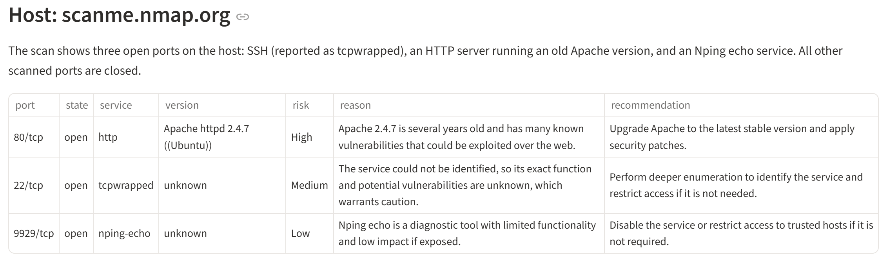

# Nmap Scan Explainer

Paste the output of an nmap scan and get a plain-language explanation of every open port: what the service is, how risky it looks, and what to do about it.

Nmap output is easy to produce and hard to read if you are new to security. This tool sends the scan to an LLM, asks for a structured answer, and shows it as a table sorted by risk.



## How it works

1. The user pastes nmap output (or picks a sample scan).
2. The app sends it to an LLM through the Groq API, with a system prompt that sets the rules and the exact JSON shape of the answer.
3. The model returns JSON: the host, a short summary, and one entry per port with service, version, risk level, reason and recommendation.
4. The app parses the JSON and shows the ports in a table, highest risk first.

## Tech

- **Python** and **Streamlit** for the interface
- **Groq API** running `openai/gpt-oss-120b`, with JSON mode for structured output
- **python-dotenv** to keep the API key out of the code

## Run it locally

You need Python 3.10 or newer and a free Groq API key from [console.groq.com](https://console.groq.com).

```bash
git clone https://github.com/sadia-mehrin-rahi/nmap-scan-explainer.git
cd nmap-scan-explainer
pip install -r requirements.txt
```

Create a file named `.env` in the project folder:

```
GROQ_API_KEY=your_key_here
```

Start the app:

```bash
python -m streamlit run app.py
```

To make your own scan to paste in:

```bash
nmap -sV scanme.nmap.org
```

`scanme.nmap.org` is a test server that the Nmap project allows people to scan. Only scan systems you own or have permission to scan.

## Prompt design

The system prompt does four things:

- Fixes the output to one JSON shape so the app can parse it reliably.
- Tells the model to use only the ports and versions that appear in the scan, so it does not invent findings.
- Treats the pasted scan as data, so instructions hidden inside it are ignored.
- Returns an error object if the text is not nmap output.

One fix came from testing. In the first version the model described a `tcpwrapped` port as "limited exposure", which is wrong: it means nmap could not identify the service because the connection closed before any data was sent. I added a rule to the prompt that explains the term, and the answer became correct.

## Limitations

- The explanation comes from an LLM and can be wrong. It is a starting point, not a security audit.
- The same scan can get a different risk level on different runs. Apache 2.4.7 was rated Medium in one run and High in another.
- The model judges versions from its general knowledge. It does not look up a vulnerability database, so it does not cite specific CVEs.
- Input is limited to 8,000 characters, which covers a single-host scan but not a large network sweep.
- It depends on the Groq free tier, which has rate limits.

## How this was built

I built this with an AI coding assistant (Claude) for the first version of the code. I ran and tested it myself, generated the sample scans, found the problems described above, and changed the prompt and the display to fix them.

## License

MIT